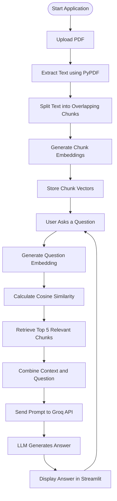

# 🤖 GenAI Document Assistant

An AI-powered PDF ChatBot application built with **Python, Streamlit, Retrieval-Augmented Generation (RAG), Sentence Transformers, and the Groq API**.

Upload a PDF document and ask questions about its content. The application retrieves relevant text from the document and uses a large language model to generate contextual answers.

🔗 **Live Demo:** https://genai-document-assistant-jgthrfuevdzcoafj5atkap.streamlit.app/

## ✨ Features

- 📄 **PDF Upload:** Upload PDF documents directly through the interface.
- 💬 **Interactive Q&A:** Ask questions about the uploaded document.
- 🔍 **Semantic Retrieval:** Uses Sentence Transformers to identify relevant text chunks.
- 🧠 **RAG Architecture:** Grounds responses in retrieved PDF content.
- ⚡ **Groq API Integration:** Generates answers using the `openai/gpt-oss-20b` model.
- 🗂️ **Conversation History:** Displays previous questions and answers during the session.
- 🔄 **Clear Chat:** Reset the conversation using the Clear Chat button.
- 🚀 **Model Caching:** Uses Streamlit resource caching to reuse the embedding model.

## 🛠️ Tech Stack

| Technology | Purpose |
|---|---|
| Python | Core application logic |
| Streamlit | Web application interface |
| PyPDF | Extracting text from PDF files |
| Sentence Transformers | Generating text embeddings |
| all-MiniLM-L6-v2 | Embedding model |
| Scikit-learn | Cosine similarity for retrieval |
| Groq API | Large language model inference |
| Git & GitHub | Version control and project hosting |

## ⚙️ How It Works

The application follows a Retrieval-Augmented Generation (RAG) workflow, combining document retrieval with an LLM to answer questions based on the uploaded PDF.

### 🔄 Application Workflow



### 📝 Workflow Explanation

1. **Upload PDF:** The user uploads a PDF through the Streamlit sidebar.
2. **Text Extraction:** PyPDF extracts the text from each page.
3. **Text Chunking:** The extracted text is divided into overlapping chunks of 1,000 characters with a 150-character overlap.
4. **Embedding Generation:** Sentence Transformers converts each chunk into a numerical vector using `all-MiniLM-L6-v2`.
5. **Question Processing:** The user's question is converted into an embedding using the same model.
6. **Similarity Search:** Scikit-learn calculates cosine similarity between the question embedding and document chunk vectors.
7. **Context Retrieval:** The five most similar chunks are selected as relevant context.
8. **Prompt Construction:** The retrieved context and user's question are combined into a prompt.
9. **LLM Inference:** The Groq API runs the `openai/gpt-oss-20b` model to generate an answer.
10. **Response Display:** The answer appears in the Streamlit chat interface, where the user can ask follow-up questions.

## 📂 Project Structure

```text
genai-document-assistant/
│
├── app.py
├── requirements.txt
└── README.md
```

## 📦 Dependencies

Your `requirements.txt` should contain:

```text
streamlit
pypdf
sentence-transformers
scikit-learn
groq
```

## ⚠️ Limitations

- The application currently supports PDF files.
- Answer quality depends on the extracted PDF text and relevance of retrieved chunks.
- Scanned PDFs may require OCR if they do not contain extractable text.
- Large documents may take longer to process.
- Generated answers may not always be accurate; verify important information against the original document.
- API usage is subject to Groq's current rate limits and availability.

## 🔮 Future Improvements

- Streaming responses for faster perceived answer time.
- Improved chunking and retrieval strategies.
- Support for multiple PDF documents.
- Persistent chat history.
- OCR support for scanned documents.
- Improved retrieval evaluation and response quality.

## 👨‍💻 Author

**Nazeer Ahmad Gaddam**

Python Developer | SQL | Data Analytics | Data Science | Exploring Generative AI & Machine Learning

---
